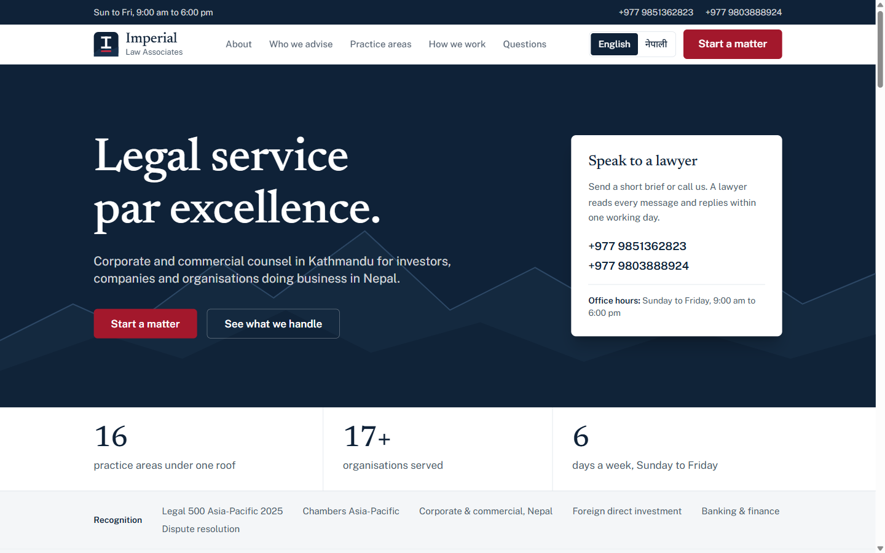
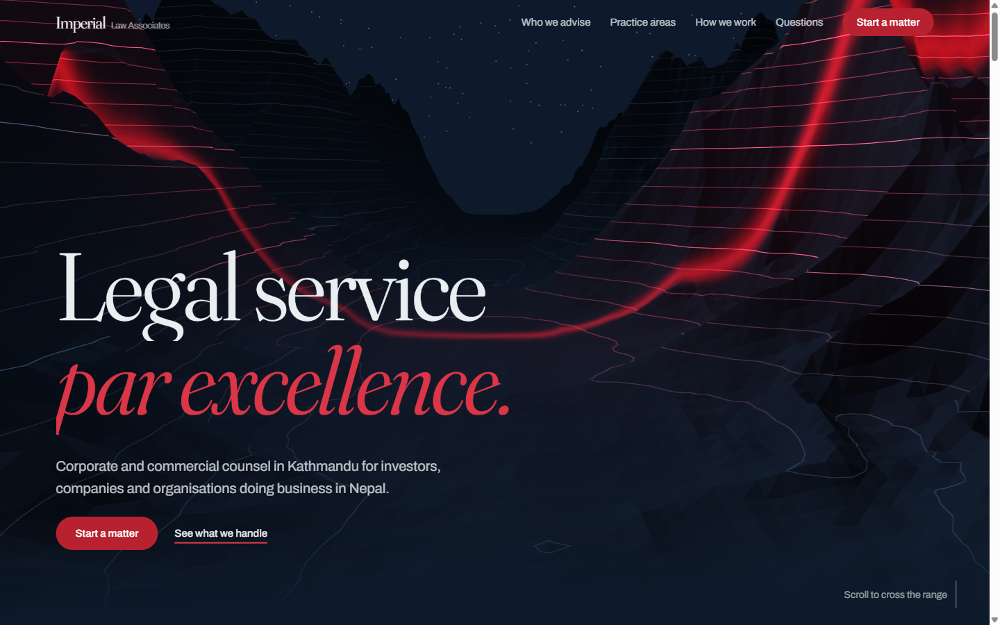
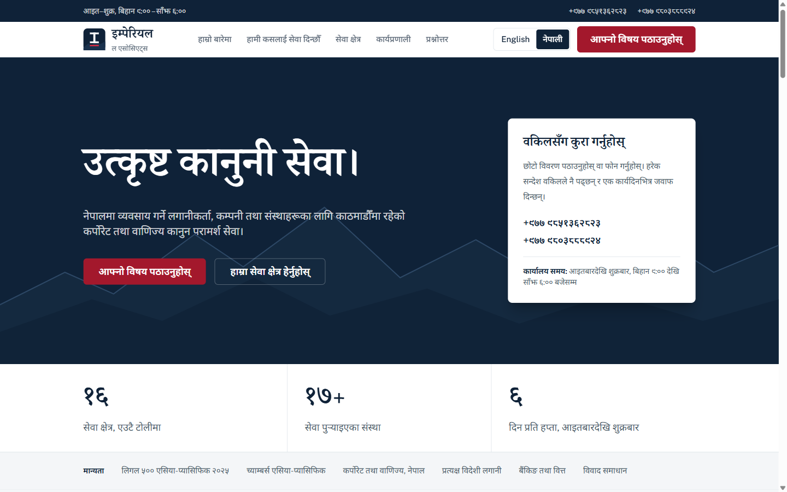
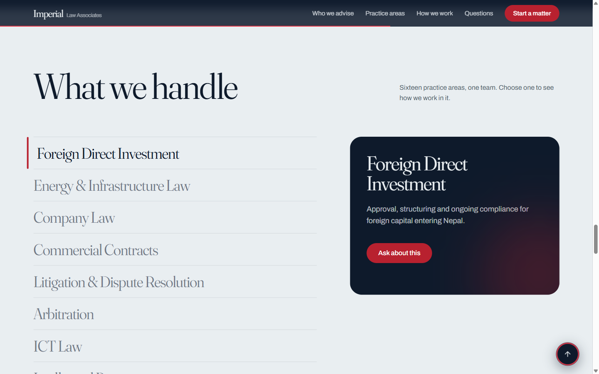
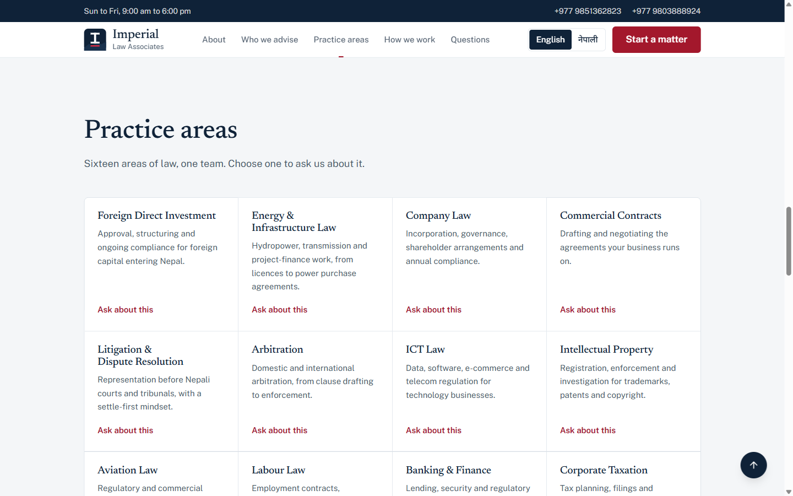
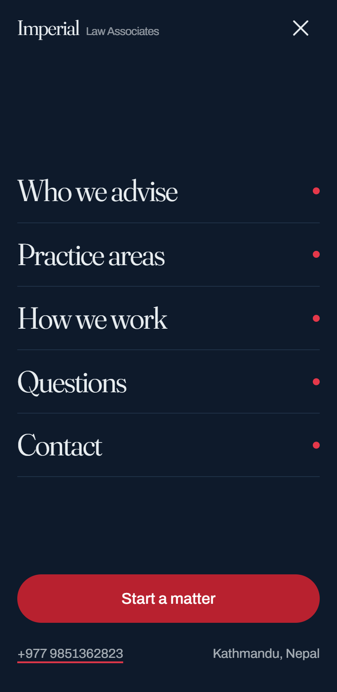
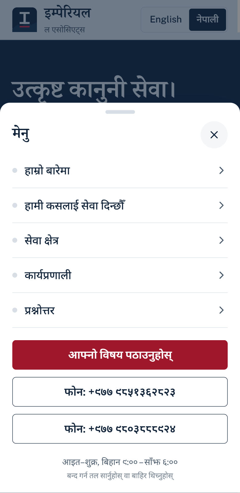
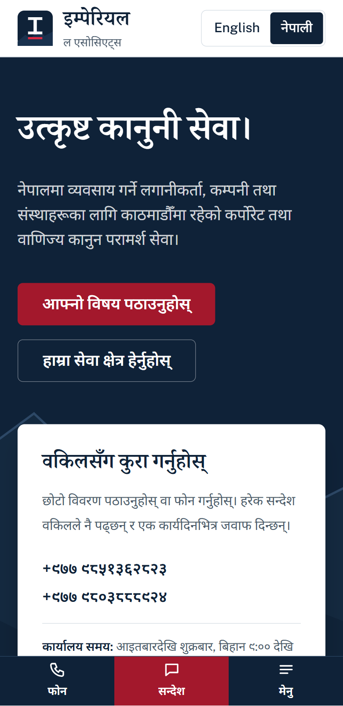

<div align="center">

# Imperial Law, Redesigned

**A calm, professional, bilingual (English / नेपाली) website for a corporate law firm in Kathmandu.**

[](https://imperial-law-demo.vercel.app)




</div>

## Why this project exists

The original site looked impressive but worked against its clients: a heavy 3D mountain hero, scroll-jacking, English only, and a menu that was hard to use on a phone. Most of the firm's clients are in Nepal and read on mobile, many of them in Nepali.

This redesign keeps the firm's content and voice and rebuilds the experience around three goals:

1. **Trust.** Look like a serious law firm in the first second.
2. **Language.** Let anyone read every word, number and link in Nepali.
3. **Mobile first.** Make calling or messaging a lawyer one tap away.

## Before and after at a glance

| | Before | After |
|---|---|---|
| First impression | Full-screen 3D mountain scene | Clear headline, a "Speak to a lawyer" card, quiet navy design |
| Language | English only | English and नेपाली on separate URLs, one-tap switch |
| Desktop menu | Transparent over a moving scene | Solid header, live section highlight, logo |
| Mobile menu | Full-screen takeover behind a hamburger | Thumb-reach bar (Call, Message, Menu) with a bottom sheet |
| Practice areas | Hover list with a side panel | All 16 areas visible in a scannable grid |
| Scrolling | Scroll-jacked, pinned sections | Normal scrolling and a short, interruptible jump to sections |
| Numbers and links | Latin digits and English labels only | Devanagari digits, translated labels, working tap-to-call |

## The cases, one by one

### 1. First impression

The old hero was a WebGL scene that needed a few seconds to settle and hid the actual offer. The new hero says what the firm does, gives two clear actions, and puts the phone numbers next to them.

| Before | After |
|---|---|
|  |  |

### 2. Language: English and नेपाली

Every page exists in two languages at real URLs (`/en` and `/ne`), so links can be shared in either language and search engines index both. A visitor whose browser is set to Nepali lands on `/ne` automatically, and the choice is remembered.

| English | नेपाली |
|---|---|
|  |  |

What changes when a reader picks Nepali: all text, the page title and description, the FAQ and firm data for search engines, form labels and error messages, the footer, the year, step and statistic numbers, and the **phone numbers** (shown in Devanagari digits while `tel:` links keep working). Devanagari gets its own fonts, extra line height and no negative letter-spacing, because the script carries marks above and below the line.

### 3. Desktop navigation

A solid header with the firm logo, a highlighted current section that follows your scroll, a language switch that is always visible, and a single red call to action. Contact details sit in a slim bar above it.

| Before | After |
|---|---|
|  |  |

### 4. Mobile navigation

The old full-screen menu hid everything and gave no direct way to call. The new design keeps the three things a client needs under the thumb. **Menu** opens a bottom sheet that closes when you tap outside it, swipe it down, press Escape, or choose a link. It shows where you are on the page and offers one-tap call buttons.

| Before | After |
|---|---|
|  |  |



### 5. Practice areas

Sixteen areas of law used to hide behind a hover list. Now they are all visible at once, each with a one-line description and an "Ask about this" link that pre-fills the contact form.

| Before | After |
|---|---|
|  |  |

### 6. Scrolling that does not fight you

Smooth scrolling in the browser took seconds to cross the long page, so clicking "How we work" or "Questions" felt frozen, and the old highlight could get stuck on the wrong item. The fix:

- Menu links run a short animation (about 0.3 to 0.7 seconds) that stops the moment you scroll yourself, and is skipped for people who prefer reduced motion.
- The highlighted menu item is computed from your scroll position, so it always matches what you are reading.
- No pinned or scroll-jacked sections anywhere.

### 7. Branding and favicon


A serif "I" over a crimson bar on the firm's navy. The same mark is the browser tab icon, the iPhone home-screen icon and the header logo, so everything matches.

<br clear="left">

## Features

- Two languages with real routes, automatic language detection and a remembered choice
- Contact form with spam protection, input validation and translated messages
- Practice areas and client types that pre-fill the form's topic and "I am" fields
- Fully keyboard accessible: skip link, visible focus, focus trapping in the mobile sheet
- Search friendly: per-language titles, `hreflang`, sitemap, `LegalService` and `FAQPage` structured data
- No tracking, no heavy animation libraries, native `<details>` for the FAQ

## Tech stack

Next.js 16 (App Router) · React 19 · TypeScript (strict) · Tailwind CSS 4 · Zod · deployed on Vercel.

Fonts: Newsreader and Public Sans for Latin, Noto Serif and Noto Sans Devanagari for Nepali.

## Getting started

```bash
git clone https://github.com/ali-sazzad/imperial-law-redesigned.git
cd imperial-law-redesigned
npm install
npm run dev        # http://localhost:3000
```

Other scripts: `npm run build`, `npm start`, `npm run typecheck`.

## Configuration

Copy `.env.example` to `.env.local`.

| Variable | Purpose |
|---|---|
| `LEAD_WEBHOOK_URL` | Contact-form messages are sent here as JSON (Zapier, Make, n8n, HubSpot...). **Required in production**: if it is unset, the form tells the visitor to call instead, and nothing is logged. In development, messages are printed to the terminal. |

## Project structure

```
src/
├─ app/
│  ├─ [locale]/        # /en and /ne pages (layout, page, SEO metadata)
│  ├─ api/leads/       # contact form endpoint
│  ├─ icon.svg         # favicon
│  └─ apple-icon.tsx   # home-screen icon
├─ components/         # Header, Hero, Trust, About, Advise, Practice, Process, Faq, Contact, Footer
├─ lib/
│  ├─ i18n/            # en.ts, ne.ts (all copy), digits.ts, config.ts
│  └─ site.ts          # facts shared by every language (phones, URL, links)
└─ proxy.ts            # picks the language for first-time visitors
```

## Adding or editing text

All copy lives in `src/lib/i18n/en.ts` and `ne.ts`. The Nepali file is typed against the English one, so a missing or misspelled key fails the build.

To add a language, create `xx.ts` with the same shape, register it in `src/lib/i18n/index.ts` and `config.ts`, and add a button in the language switch.

## Deploying

The project deploys to Vercel with no extra setup.

```bash
npx vercel          # preview
npx vercel --prod   # production
```

## Notes and next steps

- The Nepali translation should be reviewed by a native speaker or legal translator before launch.
- Social links currently point to each network's home page. Replace them in `src/lib/site.ts` with the firm's profiles.
- Ranking and client-count claims come from the original site and should be confirmed by the firm.

## Author

Built by [**@ali-sazzad**](https://github.com/ali-sazzad). If this project helped or inspired you, a star and a follow are very welcome.
