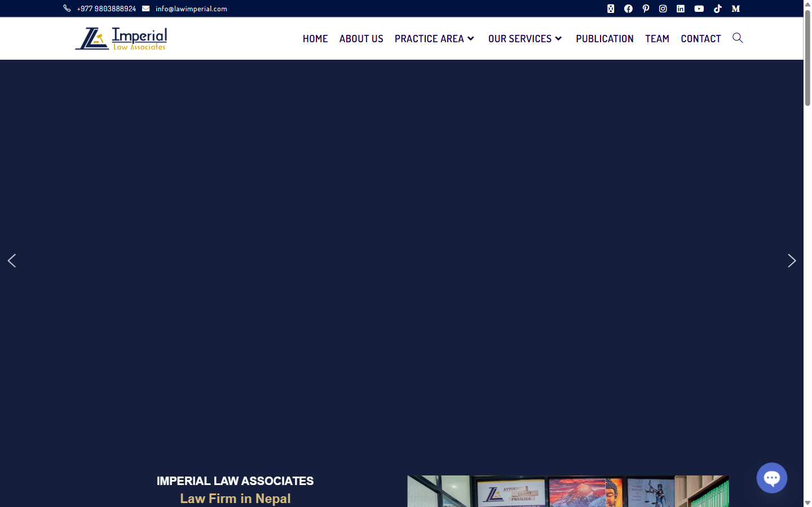
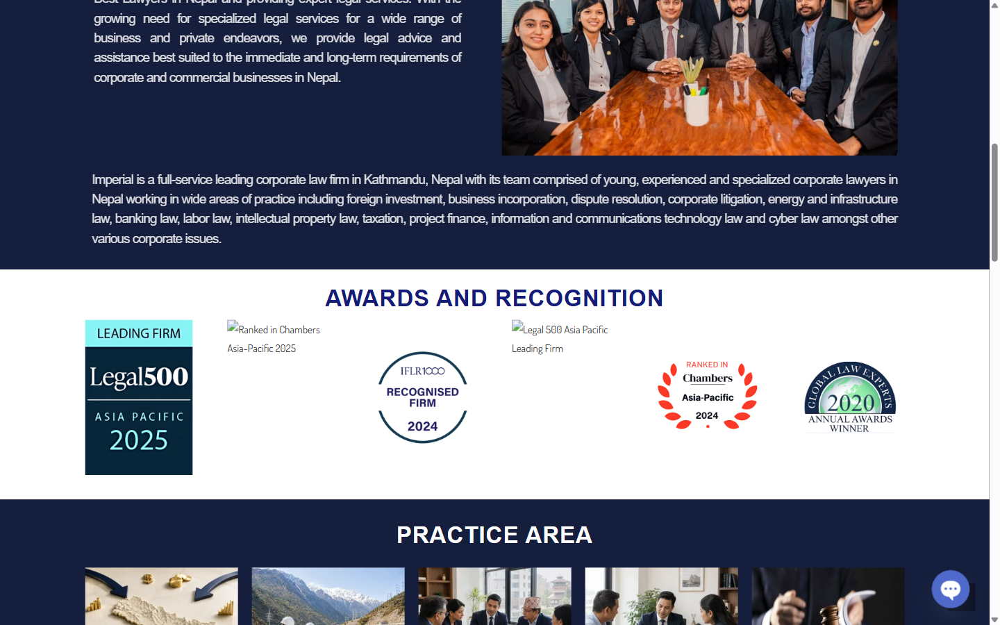
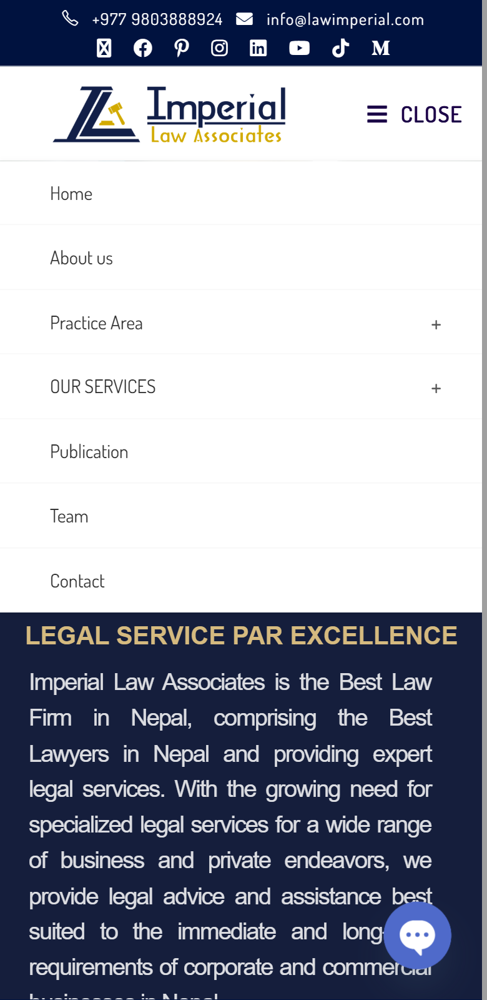

<div align="center">

# Law Imperial, Redesigned

**A professional, mobile-first, bilingual (English / नेपाली) redesign of the Imperial Law Associates website.**

[](https://www.lawimperial.com)
[](https://imperial-law-demo.vercel.app)


</div>

## Before and after

|  | Before | After |
|---|---|---|
| Site | **[lawimperial.com](https://www.lawimperial.com)**, the firm's current live site | **[Live demo](https://imperial-law-demo.vercel.app)** (this repository) |
| Languages | English only | English and नेपाली, one tap to switch |
| Phone layout | Page is 430 px wide on a 390 px screen, so it scrolls sideways | Fits the screen at every width tested (360 to 1440 px) |
| Phone navigation | Menu opens inline and pushes the page down | Bottom bar (Call, Message, Menu) and a sheet that closes when you tap outside |
| First load | About 103 requests | 16 requests |
| Numbers and links in Nepali | Not available | Devanagari digits, translated labels, working tap-to-call |

<sub>Original measured with Chrome DevTools on 17 October 2026 at 390 px (phone) and 1440 px (desktop). Request counts come from the browser's Performance API on first load.</sub>

## Why a redesign

Most of the firm's clients are in Nepal and browse on their phones, many of them preferring Nepali. The original site is full of useful content, but it is English only, crowded on small screens, and heavy to load. This project keeps the firm's services and voice and rebuilds the experience around three goals:

1. **Trust.** Look like a serious law firm in the first second.
2. **Language.** Let anyone read every word, number and link in Nepali.
3. **Mobile first.** Make calling or messaging a lawyer one tap away.

## The cases, side by side

### 1. Header and first screen

The original opens with a contact and social bar, a slider and a dense block of justified text. The redesign opens with what the firm does, two clear actions, and the phone numbers beside them.

| Before ([lawimperial.com](https://www.lawimperial.com)) | After |
|---|---|
|  |  |

### 2. Language: English and नेपाली

The original has no language option. Every page now exists in two languages at real URLs (`/en` and `/ne`), so links can be shared in either language and search engines index both. A visitor whose browser is set to Nepali lands on `/ne` automatically, and the choice is remembered.

| English | नेपाली |
|---|---|
|  |  |

When a reader picks Nepali, everything changes: all text, page title and description, form labels and errors, the footer and social link names, the year, step and statistic numbers, and the **phone numbers** (shown in Devanagari digits while `tel:` links keep working). Devanagari gets its own fonts, extra line height and no negative letter-spacing, because the script carries marks above and below the line.

### 3. Recognition and practice areas

The original shows award logos and photo cards. In the capture two of the award images failed to load and showed only their alt text. The redesign presents recognition as readable text and all 16 practice areas as a scannable grid, each with an "Ask about this" link that pre-fills the contact form.

| Before | After |
|---|---|
|  |  |

### 4. Phone: header and menu

On a phone the original stacks a contact line and eight social icons above the header, opens its menu inline so the page jumps down, and keeps a chat bubble floating over the text. The redesign keeps the three things a client needs under the thumb. **Menu** opens a bottom sheet that closes when you tap outside it, swipe it down, press Escape, or choose a link. It shows where you are on the page and offers one-tap call buttons.

| Before | Before (menu open) | After | After (menu open) |
|---|---|---|---|
|  |  |  |  |

### 5. Scrolling that does not fight you

Menu links run a short animation (about 0.3 to 0.7 seconds) that stops the moment you scroll yourself, and is skipped for people who prefer reduced motion. The highlighted menu item is computed from your scroll position, so it always matches what you are reading.

### 6. Favicon


A serif "I" over a crimson bar on navy, used as the browser tab icon, the iPhone home-screen icon and the header logo. It is a **placeholder monogram**; swap in the firm's real logo before launch (`src/app/icon.svg`, `src/app/apple-icon.tsx` and the `LogoMark` in `src/components/Header.tsx`).

<br clear="left">

## What this redesign does not include yet

Being clear about scope: the original has more pages than this homepage-focused redesign.

- Team profiles and the Publication section
- The "Our services" pages and per-practice-area pages
- Photography and the firm's real logo
- Real social profile links and the `info@lawimperial.com` address (the redesign currently links to each network's home page)
- The chat widget

These are the natural next steps, and the language system, layout and components are ready to hold them.

## Features

- Two languages with real routes, automatic language detection and a remembered choice
- Contact form with spam protection, input validation and translated messages
- Practice areas and client types that pre-fill the form's topic and "I am" fields
- Keyboard accessible: skip link, visible focus, focus trapping in the mobile sheet
- Search friendly: per-language titles, `hreflang`, sitemap, `LegalService` and `FAQPage` structured data
- No tracking, no heavy animation libraries, native `<details>` for the FAQ

## Tech stack

Next.js 16 (App Router) · React 19 · TypeScript (strict) · Tailwind CSS 4 · Zod · deployed on Vercel.

Fonts: Newsreader and Public Sans for Latin, Noto Serif and Noto Sans Devanagari for Nepali.

## Getting started

```bash
git clone https://github.com/ali-sazzad/law-imperial-redesigned.git
cd law-imperial-redesigned
npm install
npm run dev        # http://localhost:3000
```

Other scripts: `npm run build`, `npm start`, `npm run typecheck`.

## Configuration

Copy `.env.example` to `.env.local`.

| Variable | Purpose |
|---|---|
| `LEAD_WEBHOOK_URL` | Contact-form messages are sent here as JSON (Zapier, Make, n8n, HubSpot...). **Required in production**: if it is unset, the form tells the visitor to call instead, and nothing is logged. In development, messages are printed to the terminal. |
| `TRUSTED_IP_HEADER` | Self-hosting only: the header your reverse proxy sets to the visitor IP, used for rate limiting. Not needed on Vercel. |

## Project structure

```
src/
├─ app/
│  ├─ [locale]/        # /en and /ne pages (layout, page, SEO metadata)
│  ├─ api/leads/       # contact form endpoint
│  ├─ icon.svg         # favicon
│  └─ apple-icon.tsx   # home-screen icon
├─ components/         # Header, Hero, Trust, About, Advise, Practice, Process, Faq, Contact, Footer
├─ lib/
│  ├─ i18n/            # en.ts, ne.ts (all copy), digits.ts, config.ts
│  └─ site.ts          # facts shared by every language (phones, URL, links)
└─ proxy.ts            # picks the language for first-time visitors
```

## Adding or editing text

All copy lives in `src/lib/i18n/en.ts` and `ne.ts`. The Nepali file is typed against the English one, so a missing or misspelled key fails the build.

To add a language, create `xx.ts` with the same shape, register it in `src/lib/i18n/index.ts` and `config.ts`, and add a button in the language switch.

## Deploying

Deploys to Vercel with no extra setup. With the repository connected, every push to `main` goes to production and other branches get preview links.

```bash
npx vercel          # preview
npx vercel --prod   # production
```

## Notes

- The Nepali translation should be reviewed by a native speaker or legal translator before launch.
- Content such as names, numbers and rankings comes from the firm's public website and should be confirmed by the firm.
- This is an independent redesign. The original site, [lawimperial.com](https://www.lawimperial.com), remains the firm's live website.

## Author

Built by [**@ali-sazzad**](https://github.com/ali-sazzad). If this project helped or inspired you, a star and a follow are very welcome.
